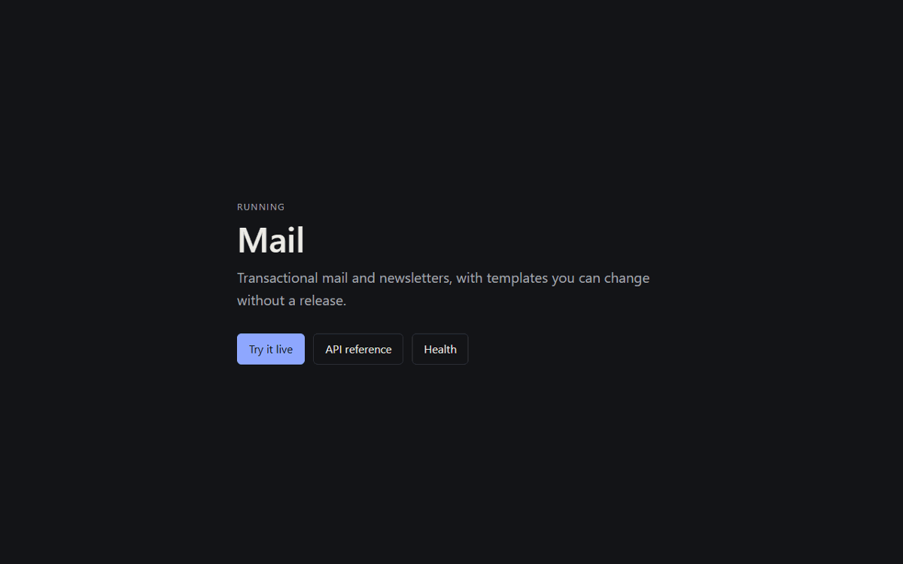
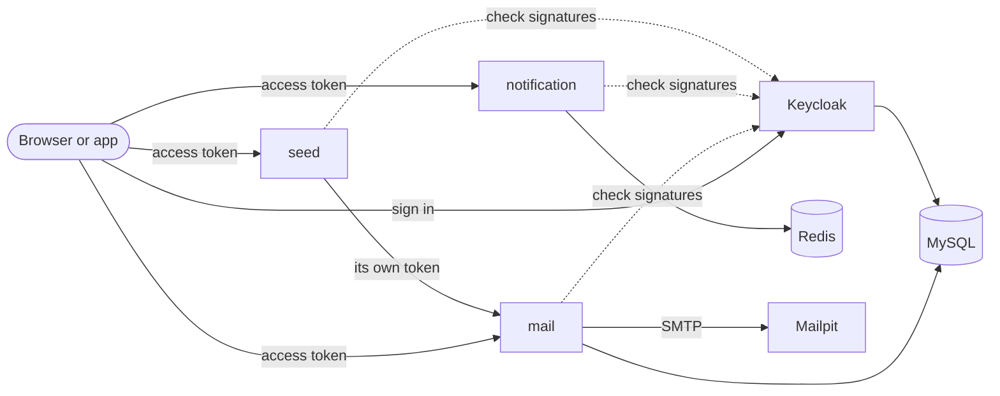

# Foundation

**Privacy first. Security by design. Purposefully small.**

Independent Java services a new project can pick from instead of writing them again. What open-source projects already do well is configured, not rewritten: [Keycloak](https://www.keycloak.org/) is the identity provider, and the services keep only the code that is specific to them.

<p align="center">
  
</p>

## What is in it

| Part | Port | What it does | Data |
|---|---|---|---|
| Identity: [Keycloak 26.8.2](platform/keycloak/foundation-realm.json) | 8081 | Registration with email verification, sign-in, passkeys, authenticator apps (TOTP), password reset, brute-force protection, invitations through organizations, roles. Configured, not coded. | MySQL |
| [`core`](core) | – | What every service shares: problem responses, request ids, a strict CSP with a nonce per response, Keycloak tokens and roles, landing and error pages, the API reference, the [design system](docs/design-system.md). | – |
| [`mail`](services/mail) | 8082 | Transactional mail and newsletters from templates you edit through the API, with an outbox that never loses a message, double opt-in and one-click unsubscribe. | MySQL |
| [`notification`](services/notification) | 8083 | In-app notifications pushed live to every open session, kept in Redis for 30 days and nowhere else. | Redis |
| [`seed`](services/seed) | 8084 | Fills any service from a YAML file: fixed values or Datafaker expressions, sent through the service's own API. | – |



Each service is its own Spring Boot application with its own `main` class (`MailApplication`, `NotificationApplication`, `SeedApplication`), its own Docker image, landing page, error page, API reference, live demo and README. A project takes only the ones it needs: they never call each other, apart from `seed`, which calls whatever its plan names.

## Run it

You need Docker with Compose v2.

```bash
cd backend
cp .env.example .env      # then replace every change-me; the comments say how to generate each value
docker compose up --build --wait
```

The first start builds three images and takes a few minutes. Keycloak needs about a minute on its own.

| Open | To |
|---|---|
| http://localhost:8082/demo/ | try newsletters: invent readers, confirm some, send a campaign |
| http://localhost:8083/demo/ | watch notifications arrive live; open it in two windows |
| http://localhost:8084/demo/ | edit a seed plan and run it against the mail service |
| http://localhost:8025 | read every email the platform sent, Keycloak's included |
| http://localhost:8081/realms/foundation/account | register, then add a passkey or an authenticator app |
| http://localhost:8081/admin | Keycloak's console: user `admin`, password `KEYCLOAK_ADMIN_PASSWORD` |
| http://localhost:8082/swagger-ui.html, :8083, :8084 | each service's API reference |

Everything is bound to `127.0.0.1`. `docker compose down` stops it; add `-v` to wipe the data.

### One service at a time

```bash
docker compose up --build --wait mail            # mail, plus MySQL, Mailpit and Keycloak
docker compose up --build --wait notification    # notification, plus Redis and Keycloak
docker compose up --build --wait seed            # seed, plus Keycloak and mail
```

From the IDE, start only what a service needs (`docker compose up --wait mysql mailpit keycloak`), then run its `main` class with the `demo` profile. It reads `.env` from the working directory.

### Without the demos

The demos run only with the `demo` profile, which Compose turns on by default here. In production, leave it off: `SPRING_PROFILES_ACTIVE=prod docker compose up --wait`.

## Signing in with Google, GitHub, Apple and others

Keycloak brokers other identity providers, so no service changes when one is added:

- **Built in:** Google, GitHub, GitLab, Microsoft, Facebook, LinkedIn, X (Twitter), Instagram, Bitbucket, PayPal, Stack Overflow, OpenShift.
- **Any OpenID Connect or SAML 2.0 provider**, through the generic provider types.
- **Apple** is not built in. It works as a generic OpenID Connect provider, but its client secret is a JWT that has to be renewed at least every six months, so most setups use the community extension [apple-identity-provider-keycloak](https://github.com/klausbetz/apple-identity-provider-keycloak), which renews it.

Add one in the console under *Identity providers*, or in `foundation-realm.json` with the client id and secret as `${ENV_VAR}` placeholders, so no secret is committed. Keycloak also ships OAuth 2.1 client policy profiles (PKCE everywhere, no implicit flow), which can be enforced on the realm. The `demo` client here already requires PKCE with S256.

## Quality

The build is strict on purpose, in every module:

| Gate | Tool | Fails the build when |
|---|---|---|
| Compiler | `javac -Xlint:all -Werror` | there is any warning |
| Static analysis | Error Prone | it finds a bug pattern, unused code or a wildcard import |
| Dead code | PMD | a private field, method or variable is never used |
| Coverage | JaCoCo | line, branch or instruction coverage drops below 90 % |
| Mutation testing | PIT | fewer than 90 % of injected bugs are caught by a test |
| Build | Gradle 9.9.0, `org.gradle.warning.mode=fail` | the build or a plugin uses a deprecated Gradle API |
| Updates | `dependencyUpdates`, in CI every day | a version pinned in `gradle/libs.versions.toml`, or Gradle, has a newer stable release |

```bash
./gradlew build                                     # everything, every gate
./gradlew :services:mail:build                      # one module
./gradlew mutationTest                              # PIT, slow: about 10 minutes for mail
./gradlew dependencyUpdates                         # fails while an update is not applied
```

On Windows, use `gradlew.bat`. Tests run against real MySQL and Redis in containers (Testcontainers), so they need Docker. Java 27 final features only, no preview flags. Dependabot proposes Gradle, Docker, Compose and GitHub Actions updates every day.

Known, and left visible on purpose: Flyway warns that MySQL 26.10 is newer than the newest version it has been verified with (9.4). No Flyway release verifies MySQL 26 yet; the warning goes away when one does.

## Layout

```text
backend
├── build-logic/          quality gates, library and service setup, the update check: written once
├── config/               PMD rules, the coverage summary and the slideshow script
├── core/                 the shared module; a service depends on it and needs no setup
├── docs/                 design system and decisions
├── gradle/libs.versions.toml
├── platform/keycloak/    the realm Keycloak imports on its first start
├── services/
│   ├── mail/
│   ├── notification/
│   └── seed/
└── compose.yaml
```

A new service is a folder under `services/` with a `build.gradle.kts` applying `example.service` and depending on `project(":core")`, a line in `settings.gradle.kts`, a Dockerfile and an entry in `compose.yaml`.

## Decisions

- [1. Keycloak for identity](docs/decisions/0001-keycloak-for-identity.md)
- [2. Mutation testing skips Spring configuration classes](docs/decisions/0002-mutation-testing-skips-configuration.md)
- [3. An outbox through Spring Modulith](docs/decisions/0003-outbox-through-spring-modulith.md)
- [4. Mustache for templates that change at run time](docs/decisions/0004-mustache-for-stored-templates.md)
- [5. Notifications live only in Redis](docs/decisions/0005-notifications-live-only-in-redis.md)
- [6. Seeding through the services' own APIs](docs/decisions/0006-seeding-through-the-apis.md)
- [7. Tests against real MySQL and Redis](docs/decisions/0007-tests-against-real-databases.md)

## Open source

This project stands on open-source projects, each under its own licence:

| Project | Used for | Licence |
|---|---|---|
| [Keycloak](https://www.keycloak.org/) | Identity and access management | Apache 2.0 |
| [Spring Boot](https://spring.io/projects/spring-boot), Spring Security, Spring Data | Framework, token validation, persistence | Apache 2.0 |
| [Spring Modulith](https://spring.io/projects/spring-modulith) | Transactional outbox for mail | Apache 2.0 |
| [Hibernate ORM](https://hibernate.org/orm/), [Flyway](https://github.com/flyway/flyway) | Persistence and migrations | Apache 2.0 |
| [JMustache](https://github.com/samskivert/jmustache) | Logic-less mail templates | BSD |
| [Datafaker](https://www.datafaker.net/) | Made-up data for seeding and demos | Apache 2.0 |
| [Jackson](https://github.com/FasterXML/jackson), [Jayway JsonPath](https://github.com/json-path/JsonPath) | YAML plans, references between steps | Apache 2.0 |
| [springdoc-openapi](https://springdoc.org/), Swagger UI | API reference | Apache 2.0 |
| [Thymeleaf](https://www.thymeleaf.org/) | Pages | Apache 2.0 |
| [Lombok](https://projectlombok.org/) | Less boilerplate at compile time | MIT |
| [MySQL](https://www.mysql.com/) | Database | GPL 2.0 |
| [Redis](https://redis.io/) | Notifications and their live channel | AGPL 3.0, among others |
| [Mailpit](https://mailpit.axllent.org/) | Local inbox | MIT |
| [Gradle](https://gradle.org/), [Eclipse Temurin](https://adoptium.net/) | Build and Java runtime | Apache 2.0, GPL 2.0 with Classpath Exception |
| [Testcontainers](https://testcontainers.com/), [JUnit](https://junit.org/), [Mockito](https://site.mockito.org/), [Awaitility](http://www.awaitility.org/) | Tests | MIT, EPL 2.0, MIT, Apache 2.0 |
| [Error Prone](https://errorprone.info/), [PMD](https://pmd.github.io/), [JaCoCo](https://www.jacoco.org/), [PIT](https://pitest.org/) | Quality gates | Apache 2.0, BSD-style, EPL 2.0, Apache 2.0 |

Every service's jar contains a CycloneDX bill of materials listing each dependency and its licence.

## License

[MIT](LICENSE) © Khova Krishna Pilato
