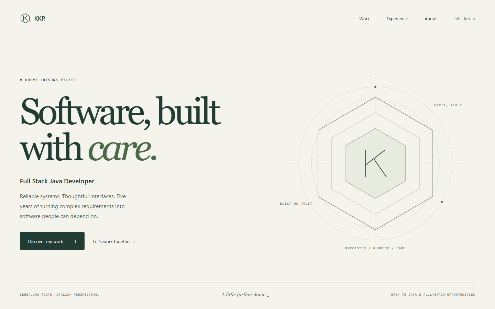
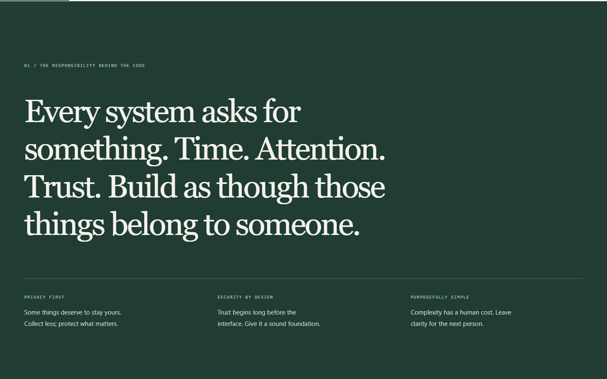
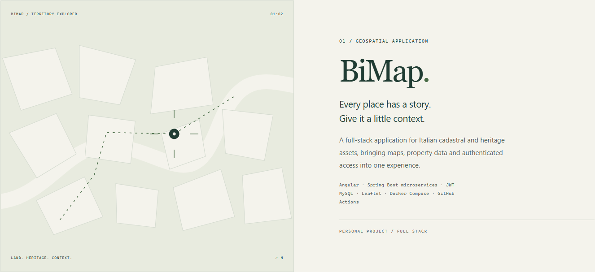

# Khova Krishna Pilato — Software, built with care

A personal portfolio built around a single idea: engineering is a form of responsibility. The visual language shares the backend’s warm paper, forest green, serif typography and geometric details, while the frontend tells a longer story for recruiters, hiring managers and engineers.

## The narrative

1. Identity, engineering focus and an immediate invitation to connect.
2. Principles: people’s time, attention, privacy and trust.
3. BiMap and PixelPaper, with original conceptual illustrations (not product screenshots).
4. Impact: ATM Milano’s notice workflow, from 20 minutes to 2.
5. Professional experience, in reverse chronological order.
6. Technical craft, grouped by responsibility.
7. Background, aviation, education and languages.
8. Contact and the next professional chapter.

Professional facts come from the supplied profile. Experience and tools live in `src/profile.ts`; editorial copy lives in `src/App.tsx`. The phone number and original PDF are not published. Update the current role and experience summary as the profile changes.

## Development

```sh
npm ci
npm run dev
npm run lint
npm run build
npm run preview
```

The deployment base remains `/portfolio/` for GitHub Pages. Change `base` in `vite.config.ts` for a different host path. The TypeScript 7 CLI is installed as `@typescript/native`; the `typescript` alias supplies the TypeScript 6 API needed by ESLint, following [Microsoft’s compatibility setup](https://devblogs.microsoft.com/typescript/announcing-typescript-7-0/#running-side-by-side-with-typescript-6.0).

## Motion and accessibility

GSAP ScrollTrigger ties word reveals and exits directly to scrolling, including reverse scrolling. SplitText supplies accessible text labels. The geometric identity, scanner line, time comparison and reading progress respond to scrolling without replacing native scrolling or pinning long passages.

Scroll animations remain enabled, including when reduced motion is requested. That preference retains the fades while limiting large translations and rotation. The final contact invitation reveals and stays visible. Native anchor navigation, a keyboard-accessible mobile menu, a skip link, visible focus states and print styles are included. A no-JavaScript fallback provides professional-profile and email links.

## Privacy and security

Assets and fonts are local. There are no analytics, tracking cookies, storage writes, embedded third-party widgets or contact forms. Contact links use email, LinkedIn and GitHub directly. Production builds inject a self-only CSP before asset tags. Development uses Vite’s normal script and style injection; it does not weaken the production policy. Frame restrictions should additionally be set through HTTP headers where the hosting service supports them.

## Preview






